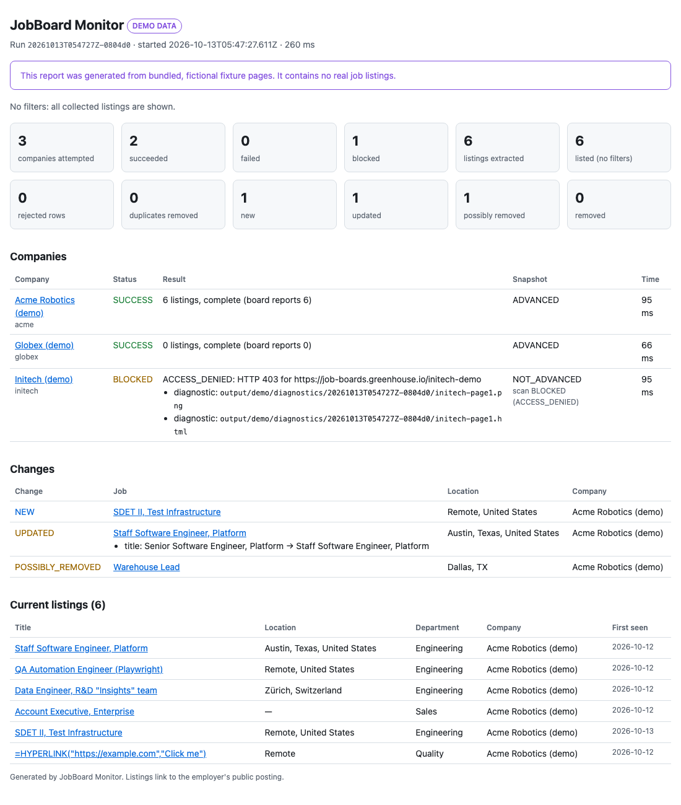

# JobBoard Monitor

[](https://github.com/ritikkatkam123/jobboard-monitor/actions/workflows/ci.yml)

> **Status: Phase 6 of 7 complete; final documentation pass pending.** This README documents only what is
> implemented today — see [docs/PROJECT_PLAN.md](docs/PROJECT_PLAN.md).

A TypeScript command-line tool that uses Playwright to collect **public** job postings
from company career boards, normalize them into one validated format, and track which
jobs are new, updated, or removed between runs.

Supported providers:

| Provider   | Board URL                          | Config field | Completeness check                                                                 | Extra fields                                       |
| ---------- | ---------------------------------- | ------------ | ---------------------------------------------------------------------------------- | -------------------------------------------------- |
| Greenhouse | `job-boards.greenhouse.io/<token>` | `boardToken` | Row count must equal the board's own "N jobs" count; paginated                     | —                                                  |
| Lever      | `jobs.lever.co/<site>`             | `site`       | Whole list on one page; an empty board must show Lever's "No job postings" message | workplace type, employment type, department / team |

## Requirements

- Node.js 22+
- npm

## Setup

```bash
npm ci
npx playwright install chromium
```

## Configuration

`config/companies.json`:

```json
{
  "settings": {
    "requestDelayMs": 1000,
    "navigationTimeoutMs": 30000,
    "maxPagesPerBoard": 40,
    "maxRetries": 2,
    "retryBaseDelayMs": 2000,
    "maxRetryAfterMs": 60000,
    "outputDir": "output",
    "stateDir": "state",
    "removedRetentionDays": 90
  },
  "companies": [
    { "id": "gitlab", "name": "GitLab", "provider": "greenhouse", "boardToken": "gitlab" },
    { "id": "spotify", "name": "Spotify", "provider": "lever", "site": "spotify" }
  ]
}
```

- `boardToken` is the part after `job-boards.greenhouse.io/`; `site` is the part after
  `jobs.lever.co/`. URLs are never accepted in config; the tool builds them itself.
- Unsupported providers are rejected by `validate-config` with the list of supported ones.
- `enabled` (default `true`) controls whether a company is included in a plain `scan`.
- Companies whose board redirects to their own careers site are not supported and fail
  with `UNEXPECTED_REDIRECT`.
- Lever's EU host (`jobs.eu.lever.co`) is not supported yet.

## Try it in 10 seconds (no network)

```bash
npm run monitor -- demo
```

The demo runs the real browser, adapter, change tracking, and reports against bundled
**fictional** pages — twice, as "yesterday" and "today" — so you see `NEW`, `UPDATED`,
`POSSIBLY_REMOVED`, and a blocked company. Nothing leaves your machine, and demo output
goes to `output/demo/`, separate from real scans.

## Commands

```bash
npm run monitor -- demo
npm run monitor -- validate-config
npm run monitor -- scan
npm run monitor -- scan --company gitlab
npm run monitor -- scan --keyword "software engineer" --keyword sdet
npm run monitor -- scan --location "Texas"
npm run monitor -- scan --dry-run
npm run monitor -- scan --trace
npm run monitor -- report --latest
npm run monitor -- --help
```

| Option                | Meaning                                                                      |
| --------------------- | ---------------------------------------------------------------------------- |
| `-c, --config <path>` | Config file (default `config/companies.json`)                                |
| `--log-level <level>` | `fatal`, `error`, `warn`, `info` (default), `debug`, `trace`, `silent`       |
| `--company <id>`      | Scan only this company; repeatable; runs even if `enabled: false`            |
| `--keyword <text>`    | Keep titles containing the text (case-insensitive); repeatable, any match    |
| `--location <text>`   | Keep locations containing the text (case-insensitive); repeatable, any match |
| `--output-dir <dir>`  | Override `settings.outputDir` (run results, diagnostics)                     |
| `--state-dir <dir>`   | Override `settings.stateDir` (snapshots)                                     |
| `--dry-run`           | Detect changes but do not save snapshots                                     |
| `--trace`             | Save a Playwright trace for companies that fail                              |

Filters change only what is reported, never what is collected. Listings without a
location never match `--location`.

`scan` prints a summary to stdout and JSON logs to stderr. `report --latest` prints the
summary of the most recent scan again, with the paths to its reports (`demo` runs are
not counted as "latest").

| Path                               | Contents                                                                 |
| ---------------------------------- | ------------------------------------------------------------------------ |
| `output/runs/<runId>/run.json`     | Full machine-readable result (`schemaVersion: 2`)                        |
| `output/runs/<runId>/jobs.csv`     | Spreadsheet: listings matching filters + their change, then removed jobs |
| `output/runs/<runId>/report.html`  | Self-contained report to open in a browser                               |
| `output/latest.json`               | Pointer to the latest completed scan                                     |
| `output/diagnostics/<runId>/`      | Screenshots, page HTML, and traces for failed companies                  |
| `state/snapshots/<companyId>.json` | Snapshot used for change tracking                                        |

## Reports

Every value in the reports comes from untrusted web pages, so:

- **CSV:** cells follow RFC 4180 (quotes doubled; cells with commas, quotes, or newlines
  are quoted). Cells starting with `=`, `+`, `-`, `@`, tab, or carriage return get a
  leading `'` so spreadsheet apps show them as text instead of running them as formulas
  (CSV injection). The file has a UTF-8 BOM so Excel shows accents and non-Latin text
  correctly.
- **HTML:** all text is HTML-escaped; only `https:` URLs become links; the page has no
  scripts, loads nothing external, and sets a Content-Security-Policy that blocks scripts
  anyway.
- **Live vs demo:** every report is labeled `LIVE DATA` or `DEMO DATA`; demo reports also
  carry a banner saying the data is fictional.

The examples below are real output from `npm run monitor -- demo` (fictional data).



Console summary:

```text
[OK  ] acme                 6 listings, complete (board reports 6)
         snapshot: ADVANCED - 1 new, 1 updated, 1 possibly removed, 0 removed
[OK  ] globex               0 listings, complete (board reports 0)
         snapshot: ADVANCED - 0 new, 0 updated, 0 possibly removed, 0 removed
[FAIL] initech              BLOCKED: ACCESS_DENIED - HTTP 403 for https://job-boards.greenhouse.io/initech-demo
         snapshot: NOT_ADVANCED (scan BLOCKED (ACCESS_DENIED))

Changes:
  NEW              SDET II, Test Infrastructure | Remote, United States | Acme Robotics (demo)
  UPDATED          Staff Software Engineer, Platform | Austin, Texas, United States | Acme Robotics (demo)
                   title: Senior Software Engineer, Platform -> Staff Software Engineer, Platform
  POSSIBLY_REMOVED Warehouse Lead | Dallas, TX | Acme Robotics (demo)
```

`jobs.csv` (first rows, plus the formula-like title showing the `'` protection):

```csv
change,company,title,location,department,url,job_id,first_seen,last_seen,changed_fields
UPDATED,Acme Robotics (demo),"Staff Software Engineer, Platform","Austin, Texas, United States",Engineering,https://job-boards.greenhouse.io/acme-demo/jobs/1001,greenhouse:acme-demo:1001,2026-10-12T05:47:27.611Z,2026-10-13T05:47:27.611Z,title
,Acme Robotics (demo),"Data Engineer, R&D ""Insights"" team","Zürich, Switzerland",Engineering,https://job-boards.greenhouse.io/acme-demo/jobs/1003,greenhouse:acme-demo:1003,2026-10-12T05:47:27.611Z,2026-10-13T05:47:27.611Z,
,Acme Robotics (demo),"'=HYPERLINK(""https://example.com"",""Click me"")",Remote,Quality,https://job-boards.greenhouse.io/acme-demo/jobs/1007,greenhouse:acme-demo:1007,2026-10-12T05:47:27.611Z,2026-10-13T05:47:27.611Z,
```

`run.json` (excerpt):

```json
{
  "schemaVersion": 2,
  "runId": "20261013T054727Z-0804d0",
  "dataSource": "demo",
  "summary": {
    "companiesAttempted": 3,
    "companiesSucceeded": 2,
    "companiesBlocked": 1,
    "listingsExtracted": 6,
    "newJobs": 1,
    "updatedJobs": 1,
    "possiblyRemovedJobs": 1,
    "removedJobs": 0
  },
  "matchedChanges": [
    {
      "kind": "UPDATED",
      "jobId": "greenhouse:acme-demo:1001",
      "fieldChanges": [
        {
          "field": "title",
          "before": "Senior Software Engineer, Platform",
          "after": "Staff Software Engineer, Platform"
        }
      ]
    }
  ]
}
```

The demo's links point at `job-boards.greenhouse.io/<name>-demo` addresses that do not exist;
they are only there so the fictional pages look like real boards.

## Retries, rate limits, and politeness

| Situation                                                             | What happens                                                                                                                                                                                                          |
| --------------------------------------------------------------------- | --------------------------------------------------------------------------------------------------------------------------------------------------------------------------------------------------------------------- |
| Timeout, network error, HTTP 408 or 5xx                               | Retried up to `maxRetries` times (default 2) with exponential backoff: about 2 s, then 4 s (+ up to 25% jitter, max 30 s). A 5xx `Retry-After` longer than the backoff is honored if it is at most `maxRetryAfterMs`. |
| HTTP 429 with `Retry-After` ≤ `maxRetryAfterMs` (default 60 s)        | Waits exactly that long and tries **once** more.                                                                                                                                                                      |
| HTTP 429 without `Retry-After`, with a longer one, or a second 429    | Stops. Company is `BLOCKED`.                                                                                                                                                                                          |
| HTTP 401/403                                                          | Stops immediately. `BLOCKED`, one request only.                                                                                                                                                                       |
| 404, off-site redirect, changed page structure, suspicious empty page | Stops immediately. `FAILED`, never retried.                                                                                                                                                                           |

- Retries happen per page, so a failure on page 3 does not restart from page 1.
- Before a retry, the browser tab is reset to a blank page so a stuck request from the previous
  attempt cannot interfere.
- Requests to the same host are spaced at least `requestDelayMs` apart (default 1 s) across the
  whole run, including between companies. Companies are scanned one at a time.
- Every retry is listed in the run JSON (`retries`) and in the console summary.

`--trace` records a Playwright trace and saves `output/diagnostics/<runId>/<companyId>-trace.zip`
only for companies that fail or are blocked. Open it with:

```bash
npx playwright show-trace output/diagnostics/<runId>/<companyId>-trace.zip
```

## Snapshots and change tracking

After each company is scanned, its result is compared with that company's last snapshot:

| Change             | Meaning                                                                                                         |
| ------------------ | --------------------------------------------------------------------------------------------------------------- |
| `NEW`              | Job ID not seen before (or seen before but confirmed removed — flagged `reappeared`)                            |
| `UPDATED`          | A tracked field changed: title, URL, location, department, employment type, workplace type, or description hash |
| `POSSIBLY_REMOVED` | Missing from one complete scan                                                                                  |
| `REMOVED`          | Missing from **two consecutive complete scans** (reported once)                                                 |

Safety rules:

- **Failed or blocked scans** (timeouts, HTTP errors, redirects, suspicious empty pages) report
  no changes and never modify the snapshot.
- **Incomplete scans** report `NEW`/`UPDATED` for what was visible but do not evaluate
  removals and do not save the snapshot, so those changes are re-checked on the next run.
  Failed and incomplete scans neither count toward removal nor reset the counter.
- A job that reappears before removal is confirmed simply becomes active again.
- Observation timestamps (`firstSeenAt`, `lastSeenAt`) and provider dates never count as an update.
- The first complete scan of a company is a **baseline**: every job is `NEW`, and the console
  summary shows a count instead of listing them.
- An unreadable snapshot is **never overwritten**. That company reports `snapshot: ERROR` and the
  run exits 1 until the file is fixed or moved away (which starts a new baseline).
- Snapshots are written atomically (temp file + rename), one company at a time.
- Confirmed-removed jobs are pruned after `removedRetentionDays`.
- A warning is shown when one complete scan makes at least half of a board's active jobs (10+)
  disappear.
- Two runs at the same time against the same `state/` folder are not coordinated yet; don't do that.

Filters (`--keyword`, `--location`) only narrow what is printed; snapshots always store the
full unfiltered board.

### Exit codes

| Code | Meaning                                                                             |
| ---- | ----------------------------------------------------------------------------------- |
| 0    | Every attempted company succeeded                                                   |
| 1    | Run finished, but at least one company failed, was blocked, or had a snapshot error |
| 2    | Invalid arguments or configuration (nothing scraped)                                |
| 3    | Unexpected internal error                                                           |

A company that succeeds but is **incomplete** (row count does not match the board's own
count, or rows were rejected) still exits 0 and is flagged `WARN` in the summary.

## Testing

```bash
npm run test:unit          # Vitest: pure logic
npm run test:integration   # Playwright: adapter vs. local fixtures, network blocked
npm test                   # both
npm run test:live          # OPT-IN: real Greenhouse + Lever boards (network required)
                           # the Lever test also compares results with Lever's official feed
npm run check              # lint + format + typecheck + unit + integration
```

## Continuous integration

`.github/workflows/ci.yml` runs on every push and pull request (read-only permissions):

1. `npm ci` from the lockfile
2. ESLint, Prettier check, TypeScript type check
3. Vitest unit tests
4. Chromium install, then the deterministic Playwright integration tests (no network)
5. Uploads the Playwright HTML report, plus traces and screenshots when tests fail

Live-site smoke tests never run in CI. Playwright retries are 0, so a failure is a failure.

## Scheduled monitoring

`.github/workflows/monitor.yml` scans the boards in `config/companies.json` on GitHub
Actions. It is **manual-only by default** (Actions tab → _Monitor job boards_ → _Run
workflow_, with optional keyword and location filters).

**Where snapshots live.** Runners are wiped after every job and caches can be evicted, so
neither is used as history. Snapshots are committed to a separate **`monitor-state`** branch
that shares no history with the source code:

- the run restores `state/` from that branch, scans, then commits and pushes only `state/`
  back to it (`scripts/state-branch.sh`);
- the first run creates the branch;
- the source branch is never modified, and generated reports are **not** committed — they are
  uploaded as a run artifact (kept 30 days) and summarized on the run page;
- runs never overlap (`concurrency: monitor`), so two runs cannot write snapshots at once;
- if some companies fail, the others' snapshots are still saved, then the run is marked failed.

The workflow needs `contents: write` only for that push. Do not merge `monitor-state` into
your main branch.

**To enable the schedule:** check `config/companies.json` lists boards you really want to
watch, uncomment the `schedule:` block in `monitor.yml`, and push it to the **default branch**
— GitHub only runs schedules from the default branch. Scheduled runs can start late or be
skipped when GitHub is busy, and GitHub disables schedules in repositories with no activity
for 60 days, so treat timings as approximate.

## Responsible use

Public boards only. No login, CAPTCHA solving, anti-bot evasion, or job applications.
HTTP 401/403 are recorded as `BLOCKED` and never retried; a 429 is waited out at most once,
and only when the site says how long to wait. Requests are sequential and spaced per host,
and images/fonts/media are not downloaded.

## License

**[PolyForm Noncommercial License 1.0.0](LICENSE)**: you may use, copy, and modify this
project for any **noncommercial** purpose, such as personal job searching, learning, research,
teaching, or use by non-profits, schools, and public institutions. **Commercial use, including
selling it or offering it as a paid service, is not permitted** without the author's permission.

This makes the project _source-available_ rather than OSI "open source". Copies must keep the
`Required Notice` line in [LICENSE](LICENSE). For commercial licensing, contact the author via
[GitHub](https://github.com/ritikkatkam123).
