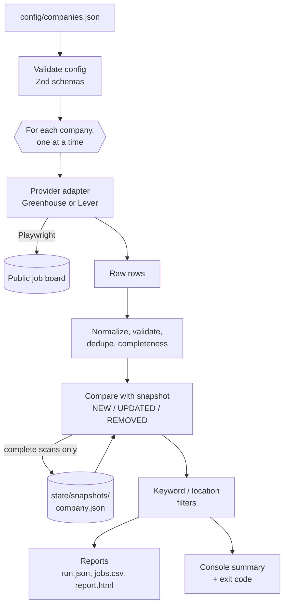
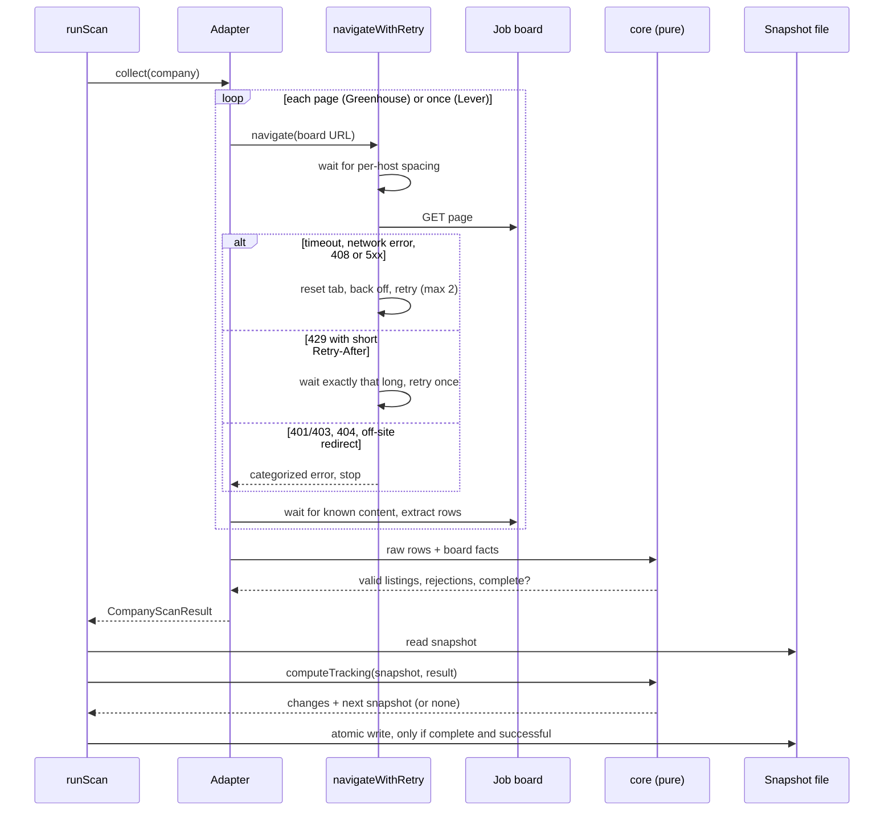

# Architecture

JobBoard Monitor is a single-process Node.js CLI. There is no server, database, or frontend:
input is a JSON config file, output is JSON/CSV/HTML files, and state between runs is one JSON
snapshot per company.

## The one rule that shapes the code

**Site-specific code is separate from business logic.** Everything that knows about HTML,
selectors, or HTTP lives in `src/adapters/` and `src/browser/`. Everything that decides what a
valid job is, whether a scan can be trusted, and what changed lives in `src/core/` — which
never imports Playwright, so it is tested with fast, pure unit tests.

## Data flow



## One company, step by step



## Modules

| Folder           | Responsibility                                                                                              | Key files                                                                 |
| ---------------- | ----------------------------------------------------------------------------------------------------------- | ------------------------------------------------------------------------- |
| `src/cli/`       | Commander program, options, exit codes. Never calls `process.exit` itself, so it is unit-testable.          | `program.ts`, `main.ts`                                                   |
| `src/config/`    | Read and validate the config file; turn Zod errors into readable messages.                                  | `load.ts`                                                                 |
| `src/schemas/`   | Zod schemas and types: config, `JobListing`, scan results, snapshots.                                       | `config.ts`, `job.ts`, `result.ts`, `snapshot.ts`                         |
| `src/browser/`   | Chromium lifecycle, navigation with redirect and status checks, retry rules, per-host throttle.             | `navigate.ts`, `navigate-with-retry.ts`, `retry-policy.ts`, `throttle.ts` |
| `src/adapters/`  | One folder per provider with its selectors and URL rules; shared result building; failure diagnostics.      | `greenhouse/`, `lever/`, `finish.ts`, `registry.ts`                       |
| `src/core/`      | Pure logic: URL canonicalization, normalization, identity, dedupe, filters, completeness, change detection. | `normalize.ts`, `url.ts`, `assemble.ts`, `changes.ts`                     |
| `src/scan/`      | Orchestrates a run: companies in sequence, crash isolation, tracking, tracing.                              | `run-scan.ts`, `track-company.ts`                                         |
| `src/storage/`   | Atomic file writes; snapshot read/write with corruption detection.                                          | `atomic.ts`, `snapshots.ts`                                               |
| `src/reporting/` | Console summary; CSV and HTML with escaping; report files and the latest-run pointer.                       | `csv.ts`, `html.ts`, `write.ts`                                           |
| `src/logging/`   | Pino JSON logs on stderr; run IDs.                                                                          | `logger.ts`                                                               |
| `src/demo/`      | Offline demo: fictional pages served to the real pipeline.                                                  | `run-demo.ts`, `fixtures.ts`                                              |

## The adapter contract

Every provider implements one interface (`src/adapters/types.ts`):

```ts
interface CareerSiteAdapter<C> {
  name: string;
  sourceUrl(company: C): string;
  collect(company: C, options: AdapterRunOptions): Promise<CompanyScanResult>;
}
```

An adapter **never throws for expected site problems**; it returns a result with a status and a
categorized error. It supplies three things the shared code cannot know:

1. **Selectors**, kept in one constant per adapter (`SELECTORS`, `LEVER_SELECTORS`) and
   recorded with the date they were observed.
2. **URL rules** (`ProviderUrlRules`): which job links are acceptable, how to canonicalize them,
   and how to read the provider's posting ID.
3. **Completeness facts**: the board's own count (Greenhouse) or that the list is on one page
   (Lever), and whether pagination finished.

Everything else — validation, dedupe, rejection reasons, status, completeness — happens in
`finishScan` and `src/core/`, so both providers follow identical rules. Adding a provider means
adding a config schema entry and an adapter; the registry's mapped type makes the compiler
refuse to build until the new provider has an adapter.

## Statuses and error categories

| Status    | Meaning                                                                                 |
| --------- | --------------------------------------------------------------------------------------- |
| `SUCCESS` | Pages loaded and extraction finished. Check `complete` before trusting absences.        |
| `BLOCKED` | The site refused access (`ACCESS_DENIED` for 401/403, `RATE_LIMITED` for 429). We stop. |
| `FAILED`  | Anything else that prevents a trustworthy result.                                       |

Error categories: `NAVIGATION_TIMEOUT`, `NETWORK_ERROR`, `HTTP_ERROR`, `NOT_FOUND`,
`ACCESS_DENIED`, `RATE_LIMITED`, `UNEXPECTED_REDIRECT`, `STRUCTURE_CHANGED`,
`SUSPICIOUS_EMPTY`, `UNKNOWN`.

## Data model

`JobListing` (`src/schemas/job.ts`) is the one shape every adapter produces. Optional business
fields are `null` when the source does not show them — never guessed.

| Field                                                       | Notes                                                                            |
| ----------------------------------------------------------- | -------------------------------------------------------------------------------- |
| `id`                                                        | `greenhouse:<token>:<id>` / `lever:<site>:<uuid>`, or `url:<hash>` as a fallback |
| `title`, `url`                                              | Validated; `url` is canonical (no tracking parameters or fragment)               |
| `location`, `department`, `employmentType`, `workplaceType` | `null` when not shown                                                            |
| `descriptionHash`                                           | Reserved for optional description tracking; currently always `null`              |
| `providerPostingId`, `sourceAdapter`                        | Provenance                                                                       |
| `firstSeenAt`, `lastSeenAt`                                 | Observation times; never used to decide that a job changed                       |

## Files on disk

```text
config/companies.json            input (committed)
state/snapshots/<company>.json   tracking state (gitignored; on monitor-state branch in CI)
output/runs/<runId>/run.json     full result (schemaVersion 2)
output/runs/<runId>/jobs.csv     spreadsheet report
output/runs/<runId>/report.html  browser report
output/latest.json               pointer to the latest completed scan
output/diagnostics/<runId>/      screenshots, page HTML, traces of failures
output/demo/                     everything the demo writes, kept apart
```

All JSON and report files are written atomically (temporary file, then rename), so an
interrupted run never leaves a half-written file behind.

## GitHub Actions

| Workflow      | Trigger                     | Permissions                           | What it does                                                                             |
| ------------- | --------------------------- | ------------------------------------- | ---------------------------------------------------------------------------------------- |
| `ci.yml`      | every push and pull request | `contents: read`                      | lint, format, type check, unit and integration tests; uploads reports and failure traces |
| `monitor.yml` | manual (schedule opt-in)    | `contents: write` (state branch only) | restores snapshots from `monitor-state`, scans, saves snapshots back, uploads reports    |

See the README's _Scheduled monitoring_ section for how state is persisted between runs.
